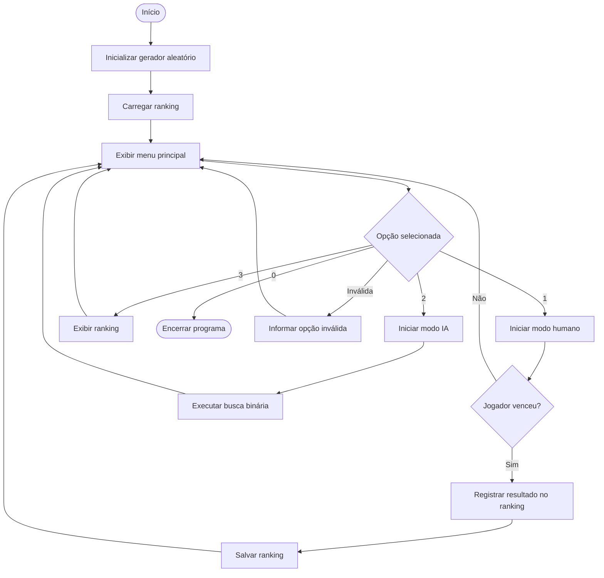

Projeto X1: Adivinhe o Número do Vilão

1. Apresentação

O Projeto X1 consiste no desenvolvimento de um jogo interativo em linguagem C, no qual o jogador deve descobrir um número secreto definido aleatoriamente pelo sistema.

O projeto também apresenta um modo de jogo no qual o computador utiliza um algoritmo de busca binária para descobrir o número pensado pelo usuário.

A aplicação foi desenvolvida com foco na aplicação prática de conceitos fundamentais de programação estruturada, modularização, manipulação de arquivos, estruturas de dados e análise de algoritmos.

2. Objetivos

- Desenvolver uma aplicação interativa utilizando a linguagem C.
- Aplicar estruturas condicionais e de repetição.
- Implementar algoritmos de busca.
- Trabalhar com vetores e estruturas (`struct`).
- Desenvolver funções e organizar o código em módulos.
- Implementar persistência de dados utilizando arquivos.
- Analisar a complexidade dos algoritmos utilizados.

3. Funcionalidades

3.1. Menu principal

Apresenta as opções de acesso aos modos de jogo, ao ranking e ao encerramento da aplicação.

3.2. Modo humano

O sistema gera um número aleatório entre 1 e 1000. O jogador possui até 10 tentativas para descobrir o número, recebendo indicações se o valor informado é maior ou menor que o número secreto.

3.3. Modo IA

O usuário escolhe mentalmente um número entre 1 e 1000. O computador utiliza busca binária para encontrar o valor por meio das respostas fornecidas pelo jogador.

3.4. Sistema de ranking

Armazena os melhores resultados, considerando a quantidade de tentativas utilizadas. Os resultados são organizados em ordem crescente de tentativas.

3.5. Persistência de dados

Os resultados do ranking são armazenados no arquivo `ranking.txt`, permitindo que os dados sejam recuperados em execuções futuras.

4. Tecnologias e conceitos utilizados

- Linguagem C (C99 ou superior).
- Biblioteca padrão da linguagem C.
- Estruturas de dados com `struct`.
- Vetores e passagem de parâmetros.
- Funções e modularização.
- Busca binária.
- Manipulação de arquivos.
- Validação de entradas.
- Estruturas condicionais e de repetição.

5. Organização dos arquivos

| Arquivo | Responsabilidade |
|---|---|
| `main.c` | Menu principal e integração dos módulos |
| `jogo.c` / `jogo.h` | Implementação do modo humano |
| `modo_ia.c` / `modo_ia.h` | Implementação do modo IA |
| `ranking.c` / `ranking.h` | Gerenciamento do ranking |
| `ranking.txt` | Armazenamento dos resultados |
| `.gitignore` | Definição dos arquivos ignorados pelo Git |

6. Compilação e execução

6.1. Requisitos

Para compilar e executar o projeto, é necessário possuir:

- Compilador GCC.
- Terminal ou ambiente de desenvolvimento compatível.
- Sistema operacional com suporte à linguagem C.

6.2. Compilação

No diretório raiz do projeto, execute o seguinte comando:

```bash
gcc -Wall -Wextra -pedantic main.c jogo.c modo_ia.c ranking.c -o jogo_novo
```

As opções utilizadas possuem as seguintes finalidades:

- `-Wall`: habilita diversos avisos importantes do compilador.
- `-Wextra`: habilita avisos adicionais.
- `-pedantic`: verifica a conformidade com os padrões da linguagem C.
- `-o jogo_novo`: define o nome do executável gerado.

6.3. Execução

Após a compilação, execute:

```bash
./jogo_novo
```

6.4. Encerramento

Para finalizar a aplicação, selecione a opção `0` no menu principal.

7. Fluxograma do menu principal

O fluxograma abaixo representa o funcionamento geral da aplicação, desde sua inicialização até o encerramento.



 8. Análise de Complexidade

A análise de complexidade permite avaliar a quantidade de operações realizadas pelos algoritmos conforme o tamanho da entrada aumenta.

8.1. Busca binária (Modo IA)

O modo IA utiliza o algoritmo de busca binária para descobrir o número pensado pelo usuário.

A cada tentativa, o intervalo de busca é dividido aproximadamente pela metade, reduzindo progressivamente a quantidade de possibilidades.

Sua complexidade temporal é:

- Melhor caso: O(1), quando o número é encontrado na primeira tentativa.
- Caso médio: O(log N).
- Pior caso: O(log N), considerando uma busca binária convencional.

Para o intervalo de 1 a 1000, são necessárias no máximo 10 tentativas, respeitando o limite estabelecido pela aplicação.

8.2. Ordenação do ranking

O ranking utiliza o algoritmo Bubble Sort para organizar os jogadores de acordo com a quantidade de tentativas.

A cada passagem pelo vetor, os elementos são comparados e trocados quando estão fora de ordem.

Sua complexidade temporal é:

- Melhor caso: O(N²), na implementação atual.
- Caso médio: O(N²).
- Pior caso: O(N²).

A implementação utiliza um vetor limitado a 10 jogadores, tornando o custo computacional pequeno para a finalidade do projeto.

8.3. Armazenamento e carregamento de dados

O sistema utiliza arquivos de texto para armazenar e recuperar os resultados do ranking.

As operações percorrem os registros armazenados no arquivo, apresentando complexidade temporal O(N), em que N representa a quantidade de registros processados.

8.4. Considerações sobre a eficiência

A busca binária foi escolhida por apresentar desempenho superior à busca sequencial em conjuntos de dados ordenados.

O Bubble Sort foi utilizado pela simplicidade de implementação e compreensão, sendo adequado ao pequeno limite de jogadores estabelecido no projeto.

Dessa forma, os algoritmos escolhidos atendem aos requisitos funcionais da aplicação e apresentam custos computacionais compatíveis com sua escala.

9. Considerações finais

O desenvolvimento do Projeto X1 possibilitou aplicar conceitos fundamentais da programação em linguagem C, integrando modularização, estruturas de dados, algoritmos de busca, ordenação e persistência de informações.

A aplicação demonstra a utilização prática da busca binária, além da organização de resultados por meio de estruturas e arquivos.

O projeto também reforça a importância da divisão de responsabilidades entre módulos e do desenvolvimento colaborativo de software.
